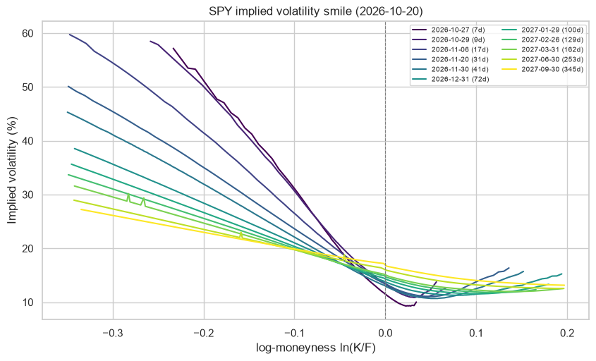
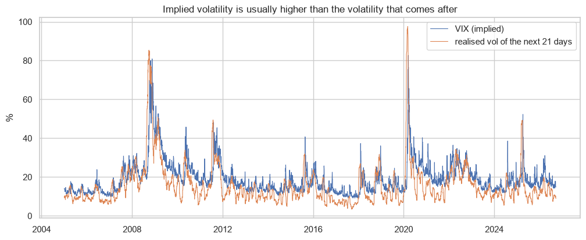

# Options: implied volatility smile, Greeks and variance risk premium

With the real option chain of SPY I calculate the implied volatility of each option with Black-Scholes and a root finder, and I build the smile, the term structure and the volatility surface. Then I compare the VIX with the volatility that really happened after.

## Data
SPY option chain (Yahoo Finance, it changes every day), VIX and 3-month T-bill (FRED), S&P 500 since 1990.

## What I did
- Forward of each expiry from put-call parity (instead of assuming a dividend)
- Implied volatility of OTM options with Brent's method, cleaning illiquid quotes
- Smile, ATM term structure, 90% skew and 3D surface
- Greeks of the ATM option with around 30 days
- VIX vs realised volatility of the next 21 days

## Main results (20 October 2026)
- Strong put skew: for the 7-day expiry a put 10% below the forward has around 21 vol points more than the ATM option, at one year only around 3.
- ATM volatility goes from 11.5% (7 days) to 16.9% (345 days).
- Since 1990 the VIX was above the realised volatility 85% of the days, by 4 points on average. But on 19 February 2020 it was 70 points below.




## How to run

```
pip install -r requirements.txt
jupyter notebook options_implied_volatility.ipynb
```

---
Alejandro Lezcano Osorio | Universidad EIA (Colombia) and Rennes School of Business (France)
